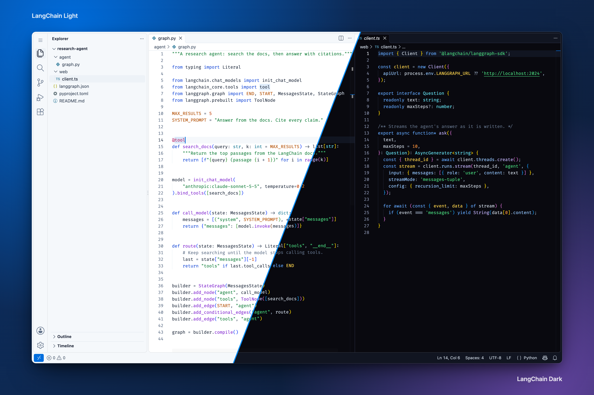

# LangChain Theme for VS Code

Light and dark VS Code themes generated from [Macaw](https://github.com/langchain-ai/macaw-design-system), LangChain's design system.



## Install

Download the `.vsix` from the latest CI run, or build it:

```sh
mise trust && mise install && mise run setup
mise run package
code --install-extension langchain-vscode-theme-*.vsix
```

Then pick **LangChain Light** or **LangChain Dark** from _Preferences: Color Theme_. Cursor and Windsurf accept the same file.

## Fonts

Macaw uses [Fira Code](https://github.com/tonsky/FiraCode) for code and [Inter](https://rsms.me/inter/) for text. The theme can't set fonts, so install them and add these to your settings:

```sh
brew install --cask font-fira-code font-inter
```

```jsonc
"editor.fontFamily": "'Fira Code', Menlo, monospace",
"editor.fontLigatures": true,
"terminal.integrated.fontFamily": "'Fira Code', Menlo, monospace",
"markdown.preview.fontFamily": "Inter, -apple-system, BlinkMacSystemFont, sans-serif",
```

Want terminal and prompt icons? Use the Nerd Font build instead. It keeps Fira Code's ligatures:

```sh
brew install --cask font-fira-code-nerd-font
```

Then use `'FiraCode Nerd Font Mono'` in place of `'Fira Code'` above. The Mono build keeps icons one cell wide, so terminal columns stay aligned.

VS Code has no setting for the interface font, so menus and the side bar keep the system font.

## How it works

`src/generate.ts` reads `tokens.json` from the installed `@langchain/macaw-tokens`, resolves each `var()` chain, layers the `html.dark` overrides for the dark variant, and writes `themes/*.json`. Mappings live in:

- `src/workbench.ts`: Macaw semantic tokens to VS Code interface colors (`--bg-surface-level-*`, `--text-*`, `--border-*`).
- `src/syntax.ts`: Macaw `--syntax-*` tokens to TextMate scopes and semantic tokens.

Tests check that every color parses and that text, syntax and terminal colors meet WCAG contrast on their backgrounds.

## Updating Macaw

Dependabot opens a PR when `@langchain/macaw-tokens` releases. CI fails until the themes are regenerated:

```sh
gh pr checkout <number>
mise run generate
git commit -am "chore: regenerate themes" && git push
```

Review the `themes/*.json` diff, then merge. If the colors changed noticeably, run `mise run screenshots` too.

## Tasks

| Task                   | What it does                                                            |
| ---------------------- | ----------------------------------------------------------------------- |
| `mise run setup`       | Install dependencies through Socket Firewall, then git hooks            |
| `mise run generate`    | Rewrite `themes/*.json` from the installed tokens                       |
| `mise run check`       | Format, lint, type check, and fail on stale themes                      |
| `mise run test`        | Unit and contrast tests                                                 |
| `mise run package`     | Build the `.vsix`                                                       |
| `mise run icon`        | Regenerate `assets/icon.png`                                            |
| `mise run screenshots` | Regenerate `docs/images/hero.png` (needs Fira Code and Inter installed) |
